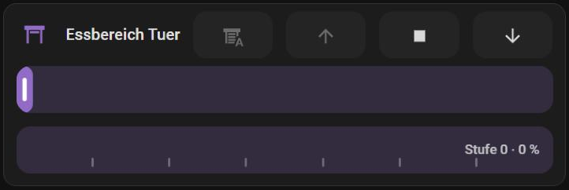

# Beschattung Karte

Raffstore/Rollladen mit Automatik, Auf/Stopp/Ab und Lamellenstufen



Enthält die Kachel-Funktionen `raffstore-lamellen-stufen` und `beschattung-steuerung`; sie müssen nicht zusätzlich installiert werden.

## Installation

### Über den Marketplace (Home Assistant 2026.11 und neuer)

1. **Einstellungen** → **Marketplace** → **Aus Link hinzufügen**.
2. Die Adresse dieses Repositorys eintragen, Kategorie **Dashboard**.
3. **Beschattung Karte** installieren. Die Ressource wird dabei automatisch eingetragen.

### Über HACS (ältere Versionen)

**HACS** → ⋮ → **Benutzerdefinierte Repositories** → Adresse dieses Repositorys, Typ **Dashboard** → installieren.

### Manuell

`beschattung-karte.js` nach `/config/www/` kopieren und unter **Einstellungen** → **Dashboards** → ⋮ → **Ressourcen**
als JavaScript-Modul `/local/beschattung-karte.js` eintragen.

## Verwendung

```yaml
type: custom:beschattung-karte
```

## Konfiguration

```
Beschattung Karte: eine Tile-Karte mit Positions- und Lamellen-Slider,
die Tasten (Automatik, Auf, Stopp, Ab) stehen rechts in der Kopfzeile neben dem Namen.

  type: custom:beschattung-karte
  entity: cover.essbereichtuer
  name: Essbereich Tuer            # optional
  color: purple                    # optional
  automatik: switch.essbereichtuer # optional
  lamellen: true                   # optional, Standard: true wenn die Beschattung Lamellen hat
  schritte: 7                      # optional, Lamellenstufen
```

## Lizenz

MIT
